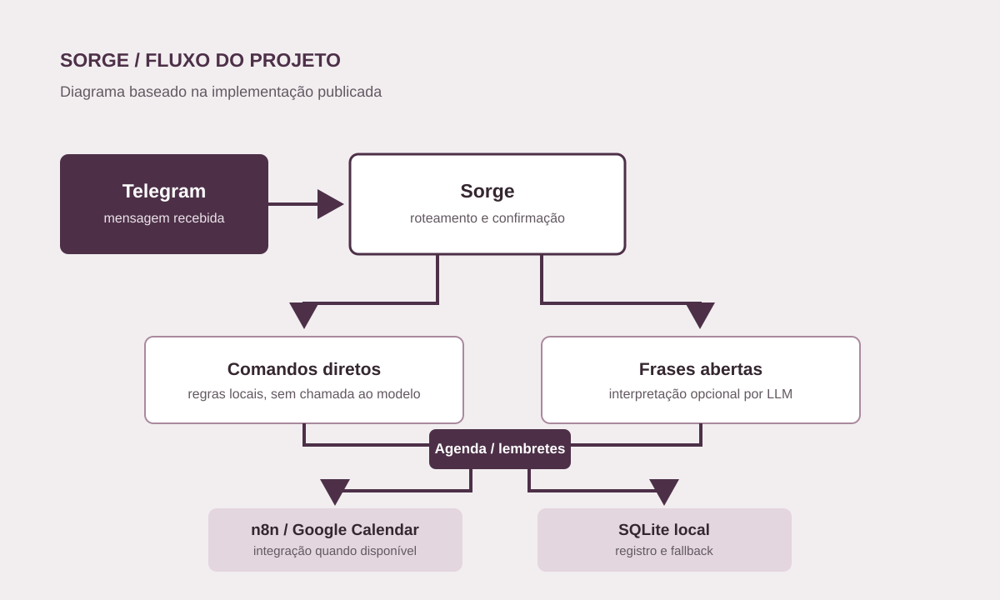

# Sorge

Assistente pessoal no Telegram para consultar a agenda, registrar compromissos e receber lembretes. Comandos conhecidos são tratados por regras locais; pedidos em linguagem natural passam pelo modelo configurado.

## Fluxo



O diagrama resume os caminhos do código. A integração com Google Calendar depende dos workflows locais do n8n; sem eles, os dados permanecem no SQLite local.

## O que oferece

- Comandos como `/hoje`, `/amanha`, `/agenda`, `/status`, `/ajuda` e `/uso`.
- Registro e confirmação de compromissos em linguagem natural.
- Lembretes pelo Telegram, incluindo recuperação de lembretes pendentes quando o serviço inicia.
- Integração opcional com Google Calendar por n8n.
- Restrição de uso ao identificador configurado em `TELEGRAM_ALLOWED_USER_ID`.

## Executar

Requer Python 3.12 ou superior. Crie um bot pelo BotFather e configure o projeto:

```bash
git clone https://github.com/lucaaregis4r-ops/Sorge.git
cd Sorge
python3 -m venv .venv
source .venv/bin/activate
pip install -r requirements.txt
cp .env.example .env
```

Edite `.env` com o token do bot e o ID autorizado. Para interpretar mensagens livres, configure um endpoint compatível com a API OpenAI, local ou remoto. O n8n só é necessário para a sincronização com o Google Calendar.

Inicie o serviço em primeiro plano:

```bash
./scripts/start-sorge.sh --foreground
```

Para executar em segundo plano, consulte os comandos em `scripts/`. O banco SQLite fica em `data/sorge.db`.

## Dados e privacidade

Comandos diretos e armazenamento do banco são locais. Mensagens que precisam de interpretação são enviadas ao endpoint configurado; se ele for hospedado por terceiros, esse serviço recebe o texto enviado. O Telegram também recebe as mensagens necessárias para operar o bot. Mantenha `.env` e o banco fora do Git e configure apenas o ID autorizado.

## Documentação

- [Plano de implementação V1](docs/plans/v1-local-telegram.md)
- [Prompt de interpretação](prompts/intent-parser.md)
- [Código e migrações do banco](database/)
- [Licença MIT](LICENSE)
